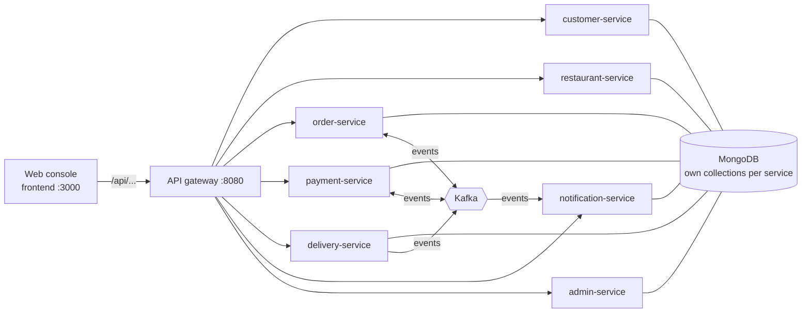

# Assignment 2 — Distributed Food Delivery Platform

Seven Ballerina microservices, each owning its own MongoDB collections, coordinated
through Kafka events. Clients reach them through one API gateway, and a browser console covers
every workflow.

## Architecture



All data lives in one MongoDB instance (database `food_delivery`). A service only ever reads
and writes its own collections; anything it needs from another service arrives as a Kafka
event or through that service's HTTP API.

## Order lifecycle

| Step | Who acts | Event | Result |
| --- | --- | --- | --- |
| Place order | Customer → order service | `orders.created` | Order `CREATED`; payment service opens a `PENDING` payment |
| Approve payment | Payment service | `payments.completed` | Order `CONFIRMED` |
| Cook | Kitchen → order service | `orders.preparing`, `orders.ready` | Order `PREPARING`, then `READY` |
| Assign driver | Delivery service | `delivery.assigned` | Order `OUT_FOR_DELIVERY` |
| Deliver | Driver → delivery service (`PICKED_UP` → `IN_TRANSIT` → `DELIVERED`) | `delivery.completed` | Order `DELIVERED` |

A declined payment publishes `payments.failed`. Orders can be cancelled until cooking finishes
(`orders.cancelled`). The notification service consumes the lifecycle topics and records a
notification for each step. Kafka creates the topics automatically the first time they are used.

## Folder structure

| Path | Contents |
| --- | --- |
| [`gateway/`](gateway) | API gateway: forwards `/api/{service}/...` to the owning service |
| [`services/<name>Service/`](services) | One Ballerina package per service: `service.bal` (HTTP API), `types.bal`, `*_persistence.bal` (MongoDB), `*_repository.bal` (in-memory store used by unit tests), Kafka integration, and `tests/` |
| [`frontend/`](frontend) | Web console (HTML, Tailwind, plain JavaScript) served by nginx, which proxies `/api` to the gateway |
| [`infra/docker/`](infra/docker) | The Docker Compose file, `.env`, and MongoDB scripts that create each service's collections |
| [`tools/seed.py`](tools/seed.py) | Loads sample Windhoek restaurants, customers and drivers, then runs orders through the whole flow |

## Run it

Requirements: Docker Desktop. From `infra/docker`:

```powershell
docker compose up -d
```

That starts 11 containers: the 7 services, MongoDB, Kafka, the gateway and the web console.
The first run builds the images, which takes a few minutes. Then load sample data and open
the console:

```powershell
python ..\..\tools\seed.py
start http://localhost:3000
```

See [`infra/docker/README.md`](infra/docker/README.md) for stopping without losing data,
rebuilding, and resetting the database.

## Ports

| Component | Host port | Base path |
| --- | ---: | --- |
| Web console | 3000 | `/` |
| API gateway | 8080 | `/api/{customers,restaurants,orders,payments,delivery,notifications,admin}/...` |
| order-service | 8081 | `/orders` |
| customer-service | 8082 | `/customers` |
| notification-service | 8083 | `/notifications` |
| payment-service | 8084 | `/payments` |
| admin-service | 8085 | `/admin/reports` |
| delivery-service | 8086 | `/delivery` |
| restaurant-service | 8087 | `/restaurants` |
| MongoDB | 27017 | database `food_delivery` |
| Kafka | 29092 (`kafka:9092` inside Docker) | |

Every service listens on 9090 inside the Docker network and has `GET .../health`.
Service settings (port, MongoDB connection, Kafka) are passed as Ballerina TOML in the
`BAL_CONFIG_DATA` environment variable in `docker-compose.yml`.

## Tests

Each service has unit tests that run against the in-memory backend, so no database is needed:

```powershell
cd services\orderService
bal test
```
