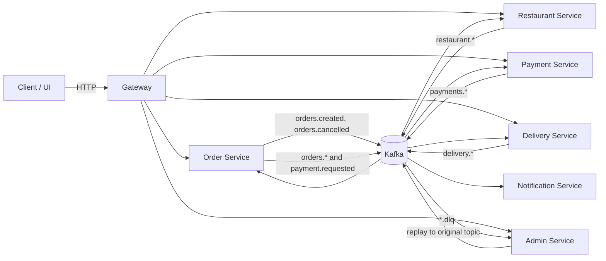

# Kafka in Assignment 2

This document describes the Kafka implementation currently present in
Assignment 2: its role in the food-delivery system, event contract, topic
inventory, service ownership, deployment, processing guarantees, dead-letter
handling, and ways to inspect it.

## At a glance

Kafka is the asynchronous event bus between the order, restaurant, payment,
delivery, notification, and admin services. HTTP requests enter through the
gateway and service APIs; Kafka carries lifecycle events between services.
Consumers update their own service state and publish follow-up events. Kafka is
not used by the browser directly: the UI obtains state through HTTP APIs and
polling.

The deployed broker is a single Confluent Kafka 7.6.0 instance backed by
ZooKeeper, with plaintext listeners and 3 partitions per application topic.
There are 23 base event topics and 23 corresponding `.dlq` topics (46 total).
The configured replication factor is 1, so this is a development/demo setup,
not a highly available Kafka cluster.

## Event flow

An order is created synchronously over HTTP and persisted before
`orders.created` is published. The restaurant consumes that event, then its
HTTP actions publish events such as `restaurant.accepted` or
`restaurant.rejected`. Order consumes the restaurant result, advances its
state, and publishes an `orders.*` event; acceptance also causes Order to
publish `payment.requested`. Payment publishes a payment result, which Order
consumes and uses to advance the lifecycle. When an order becomes ready,
Delivery consumes `orders.ready`, assigns a driver, and emits
`delivery.assigned` (or `delivery.not_assigned`). Delivery actions publish
pickup/completion events, which Order consumes. Notification independently
consumes order lifecycle topics and writes notifications for recipients.
Cancellation events are consumed by the relevant services to update their
local state.

The HTTP services remain the user-facing control plane. Kafka is the
service-to-service event plane; it does not replace the gateway or HTTP APIs.
See the [system architecture](./docs/architecture.md) and the service
implementations linked below.

## Event format and partitioning

Application event values are UTF-8 JSON envelopes with this common shape:

| Field | Meaning |
| --- | --- |
| `eventId` | Unique event identifier used for duplicate detection and recovery |
| `eventType` | Base topic/event name, normally identical to the Kafka topic |
| `occurredAt` | UTC event timestamp |
| `orderId` | Order the event concerns |
| `correlationId` | End-to-end correlation identifier, normally retained from the source event |
| `producerService` | Service which emitted this event |
| `data.orderSummary` | Shared order/customer/restaurant/amount/address context |
| `data.payload` | Event- or service-specific data |

The producer key is the UTF-8 `orderId`. This keeps events for one order on the
same partition within a topic, preserving their partition order. Each
producer uses `acks: "all"` and `retryCount: 3`; producers generally flush
after sending. These settings do not provide exactly-once processing.

The reusable envelope and topic definitions live in
[shared/contracts/types.bal](./shared/contracts/types.bal). Runtime services
currently define local event record types and construct JSON themselves rather
than importing the shared contract. The contract therefore describes the
intended common shape, but it is not a single enforced serialization boundary
across all services.

## Topic inventory

The canonical base-topic list in code is
[shared/contracts/types.bal](./shared/contracts/types.bal). The Docker
initializer's expected list is
[expected-topics.txt](./infra/docker/kafka/expected-topics.txt). Every row
below has a matching `<topic>.dlq` topic, for 46 topics altogether.

| Topic family | Base topics | Main producer(s) | Main consumer(s) |
| --- | --- | --- | --- |
| Order lifecycle | `orders.created`, `orders.confirmed`, `orders.preparing`, `orders.ready`, `orders.out_for_delivery`, `orders.delivered`, `orders.cancelled`, `orders.autocancelled` | Order publishes creation/cancellation and derived lifecycle state events | Restaurant consumes created/confirmed/preparing/cancelled/autocancelled; Delivery consumes ready/cancelled/autocancelled; Payment consumes cancelled/autocancelled; Notification consumes all eight; Order consumes downstream service results |
| Payment | `payment.requested`, `payments.completed`, `payments.failed`, `payments.cancelled`, `payments.refunded` | Order publishes `payment.requested`; Payment publishes completed/failed/refunded results | Payment consumes payment requests and order cancellations; Order consumes completed/failed; the other topics are available for lifecycle extensions |
| Restaurant | `restaurant.accepted`, `restaurant.rejected`, `restaurant.preparing`, `restaurant.ready` | Restaurant | Order consumes all four; the matching `.dlq` topics are consumed by Admin |
| Delivery | `delivery.assigned`, `delivery.picked_up`, `delivery.not_assigned`, `delivery.completed`, `delivery.cancelled`, `delivery.failed` | Delivery | Order consumes assigned/picked_up/completed/not_assigned/failed; the matching `.dlq` topics are consumed by Admin |

All 23 base topics have a dead-letter companion. The current Admin consumer
subscribes to all 23 `.dlq` topics.

Some base topics are provisioned as part of the common contract even though
the current service code does not publish them in the normal flow. In
particular, `payments.cancelled`, `delivery.cancelled`, and `delivery.failed`
are part of the topic inventory; their presence in Kafka does not imply a
current producer path.

## Service responsibilities

| Service | Kafka role | Consumer group / subscriptions | Behavior |
| --- | --- | --- | --- |
| Order | Producer and consumer | `order-service`; restaurant results, payment completed/failed, and delivery assigned/picked_up/completed/not_assigned/failed | Publishes `orders.created`, cancellation, derived order lifecycle events, `payment.requested`, and DLQ records for its own failed inputs. Applies transitions, maintains pending-event recovery, and commits offsets manually. |
| Restaurant | Producer and consumer | `restaurant-service`; orders.created/confirmed/preparing/cancelled/autocancelled | Stores kitchen orders and reacts to confirmation/cancellation. HTTP restaurant actions publish accepted/rejected/preparing/ready events. |
| Payment | Producer and consumer | `payment-service`; payment.requested and orders.cancelled/autocancelled | Creates or updates a payment, publishes completed/failed/refunded, and commits offsets manually. |
| Delivery | Producer and consumer | `delivery-service`; orders.ready and orders.cancelled/autocancelled | Assigns a driver on ready, handles cancellations, publishes assignment and delivery progress events, and commits offsets manually. |
| Notification | Consumer only | `notification-service`; all eight `orders.*` lifecycle topics | Creates customer notifications for order events and a restaurant notification for `orders.created`. It does not publish Kafka events. |
| Admin | Consumer and producer | `admin-service`; all 23 `.dlq` topics | Audits DLQ records to MongoDB and exposes HTTP inspection/replay endpoints. Replay republishes the stored original payload to its original base topic. |

Customer Service does not implement a Kafka consumer. The browser does not
connect to Kafka. The optional Kafka feed described in the client notes is not
part of the current browser runtime.

## Runtime configuration

All six Kafka-using services pin `ballerinax/kafka` version `4.6.6` in their
Ballerina package manifests. Each service defaults to `kafka:9092`, with
`kafkaRuntimeEnabled` defaulting to `false` so isolated unit tests do not need a
broker. Docker and Kubernetes set the runtime flag to `true` and the bootstrap
address to `kafka:9092`. The services create their consumers during service
initialization and schedule polling jobs at roughly one-second intervals.

In Docker Compose, ZooKeeper, Kafka, and the one-shot `kafka-init` service are
shared by each application profile. The internal broker address is
`kafka:9092`; host-side tools use `localhost:29092`. ZooKeeper is exposed on
`localhost:2181`. The Kafka topic initializer waits for broker health, creates
missing topics idempotently, and verifies the full expected inventory.

In Kubernetes, [kafka-infrastructure.yaml](./infra/k8s/kafka-infrastructure.yaml)
defines a ZooKeeper Deployment/Service, one Kafka Deployment/Service, and a
`kafka-init` Job. The broker advertises `kafka:9092` for in-cluster clients and
`kafka:29092` on its second listener. The Job creates each base and DLQ topic
with 3 partitions and replication factor 1. The application deployments use
`kafka:9092`; their Kafka flags are set in
[ballerina-microservices.yaml](./infra/k8s/ballerina-microservices.yaml).

Both deployment definitions disable automatic topic creation. Topics must be
created by the initializer before dependent consumers can operate. Both use
plaintext listeners; authentication and TLS are not configured. Neither
manifest attaches persistent storage to the Kafka broker, so broker log
durability across broker replacement is not configured. With one broker and
replication factor 1, there is no broker-level fault tolerance.

## Delivery, retries, and durability

Kafka consumers use manual offset commits (`autoCommit: false`) and request
earliest offsets for a new consumer group. Committing is done at the
application handler boundary, but error behavior differs:

* **Order** retries business processing up to `consumerRetries` (default 3),
  with configurable backoff values (defaults 1 and 5 seconds). It records a
  durable processing claim, handles pending events, and commits after a
  successful transition or a completed DLQ handoff. Its Mongo-backed outbox
  supports republishing pending events after restart. The outbox is not a
  transaction with Kafka; publication is at-least-once and downstream event
  IDs are used for deduplication. The source comment in
  [mongo_persistence.bal](./services/orderService/mongo_persistence.bal)
  explicitly notes the absence of connector transactions.
* **Restaurant, Payment, Delivery, and Notification** use manual commits too,
  but their duplicate-tracking and error handling are not uniform. Several
  use process-local event-ID maps; those maps are lost on restart. Decode and
  envelope failures in these consumers are committed rather than parked,
  while some persistence/publication failures are left uncommitted for later
  redelivery.
* **Order DLQ production** is implemented for Order's consumer. The other
  consumers do not currently share a common retry-to-DLQ mechanism. The
  existence of a `.dlq` topic for every base topic should not be interpreted
  as proof that every consumer sends failures there.
* **Payment restart behavior** is specifically recorded as a known issue in
  [bugs.md](./plan/bugs.md): Kafka-created payment state and processed event IDs
  are currently process-local in the implementation. See that issue before
  relying on restart-safe payment processing.

The Order producer stores an outbox record before publishing when an event has
an `eventId`; an asynchronous flush path marks the record published after the
flush completes. Recovery periodically republishes stale pending rows. This
narrows the persistence/publication gap but can produce duplicates, so it is
not equivalent to exactly-once delivery.

## Dead-letter audit and replay

When Order exhausts retries or cannot decode/validate an input event, it
publishes a diagnostic envelope to `<original-topic>.dlq`. The value contains
`originalTopic`, the Kafka key, original raw payload, error text, attempt
count, consumer group, and failure timestamp.

Admin reads all DLQ topics using the `admin-service` group. It persists each
record to the `dlq_log` MongoDB collection, keyed by the DLQ topic/partition/
offset so redelivery of the same Kafka location is idempotent. A record that
cannot be decoded or stored is logged and left uncommitted. The endpoints are
exposed through Admin's HTTP service:

* `GET /admin/dlq` lists audited records.
* `POST /admin/dlq/replay` validates the requested base topic and JSON payload,
  republishes the original key and raw payload, and records replay status for
  payloads with an `eventId`.

Replay is protected against a repeated replay for the same topic/event ID when
that ID is present. Payloads without an event ID can be replayed more than
once. Replay sends the original JSON value unchanged; it does not rewrite its
event ID.

## Operational checks

From `Assignment-2/infra/docker`:

* `.\kafka\check-topics.ps1` verifies that exactly 46 expected topics exist
  (requires Kafka CLI tools on the host), or use
  `.\kafka\check-topics.sh` in a Bash environment.
* `.\scripts\check-consumers.ps1` inspects consumer group membership and lag.
* `.\scripts\test-kafka-lifecycle.ps1 -OrderId <id>` checks that an order
  produced `orders.created` and a correlated restaurant result.
* The `test-order-*.ps1`, `test-at-*.ps1`, and `test-admin-dlq-audit.ps1`
  scripts exercise failure/recovery, event lifecycle, and DLQ audit paths.

The Compose [README](./infra/docker/README.md) describes startup profiles and
startup troubleshooting. A healthy Kafka broker alone does not mean topic
initialization completed or consumers joined their groups; verify the
initializer and consumer groups separately.

## Source map

| Concern | Implementation |
| --- | --- |
| Shared event schema and base topics | [shared/contracts/types.bal](./shared/contracts/types.bal) |
| Order producer and outbox publication | [services/orderService/kafka.bal](./services/orderService/kafka.bal), [services/orderService/mongo_persistence.bal](./services/orderService/mongo_persistence.bal) |
| Order consumer, transitions, retry and DLQ publication | [services/orderService/kafka_consumer.bal](./services/orderService/kafka_consumer.bal) |
| Restaurant runtime | [services/restaurantService/kafka_runtime.bal](./services/restaurantService/kafka_runtime.bal) |
| Payment runtime | [services/paymentService/kafka_runtime.bal](./services/paymentService/kafka_runtime.bal) |
| Delivery runtime | [services/deliveryService/kafka_runtime.bal](./services/deliveryService/kafka_runtime.bal) |
| Notification runtime | [services/notificationService/event_consumer.bal](./services/notificationService/event_consumer.bal) |
| Admin DLQ consumer, persistence and replay | [services/adminService/dlq_consumer.bal](./services/adminService/dlq_consumer.bal), [services/adminService/dlq_store.bal](./services/adminService/dlq_store.bal), [services/adminService/dlq_replay.bal](./services/adminService/dlq_replay.bal) |
| Docker broker and topic initialization | [infra/docker/docker-compose.yml](./infra/docker/docker-compose.yml), [infra/docker/kafka/create-topics.sh](./infra/docker/kafka/create-topics.sh), [infra/docker/kafka/expected-topics.txt](./infra/docker/kafka/expected-topics.txt) |
| Kubernetes broker, topic Job, and service configuration | [infra/k8s/kafka-infrastructure.yaml](./infra/k8s/kafka-infrastructure.yaml), [infra/k8s/ballerina-microservices.yaml](./infra/k8s/ballerina-microservices.yaml) |
